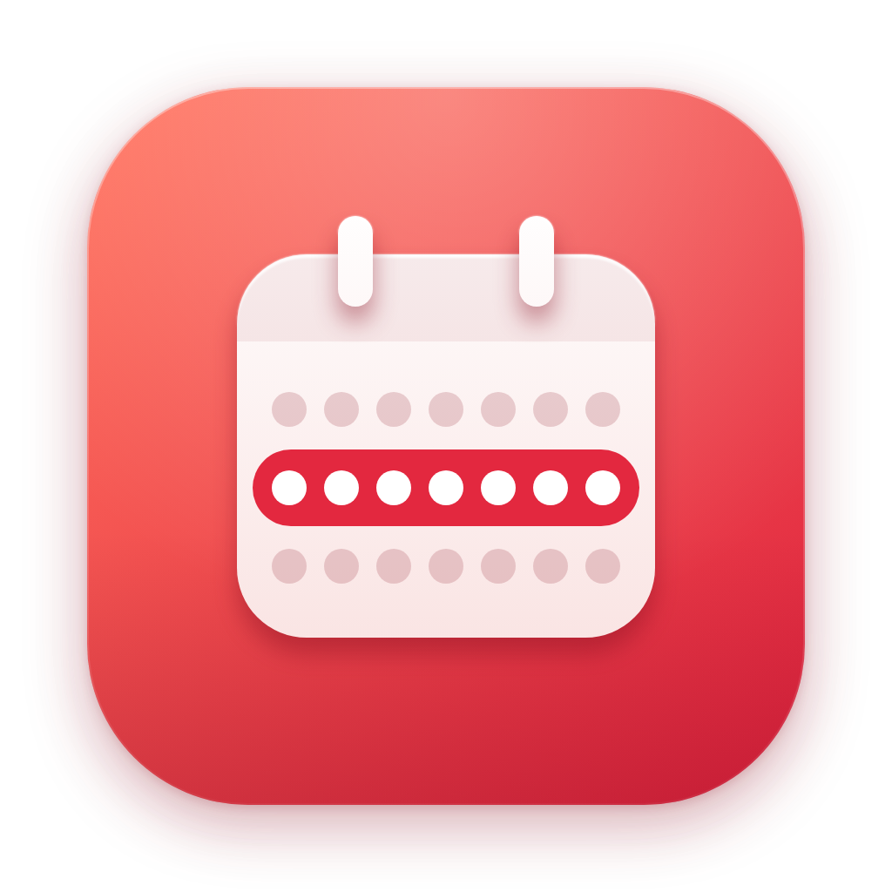
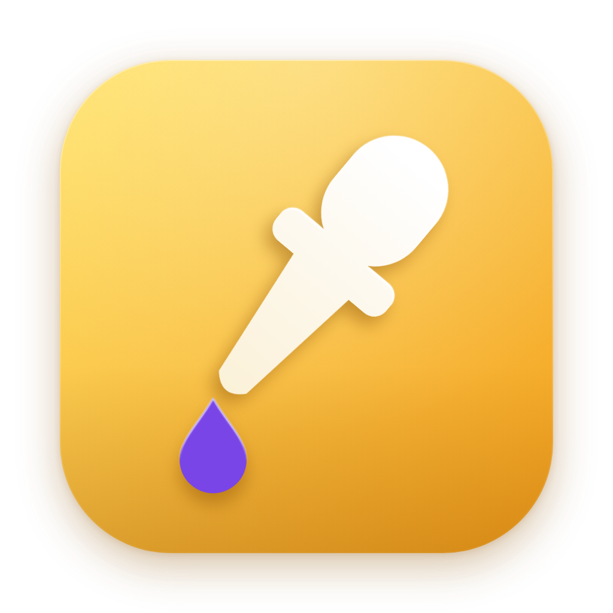
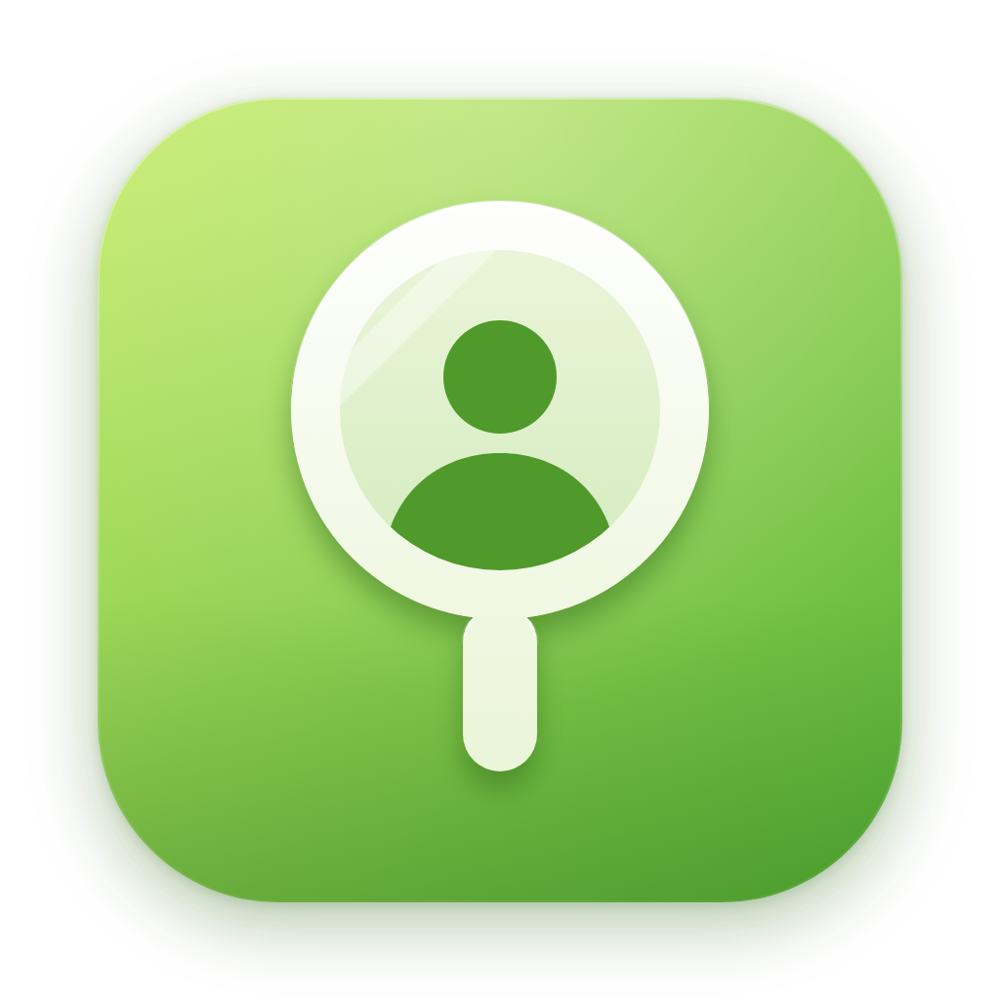
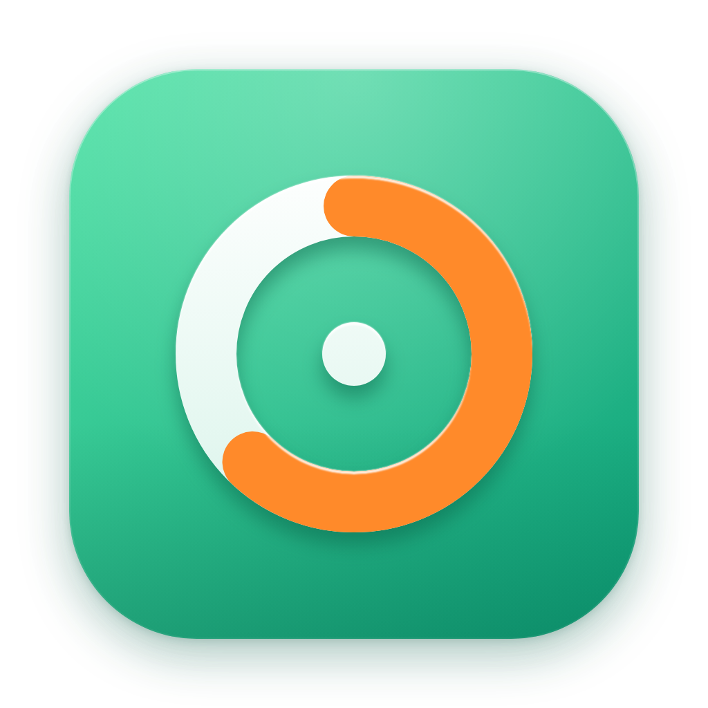
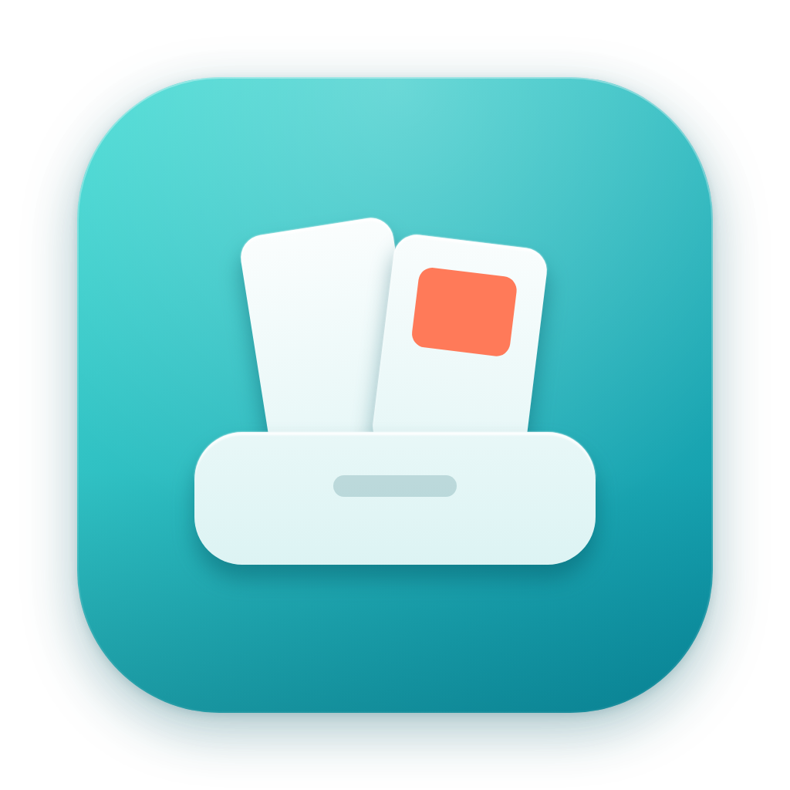
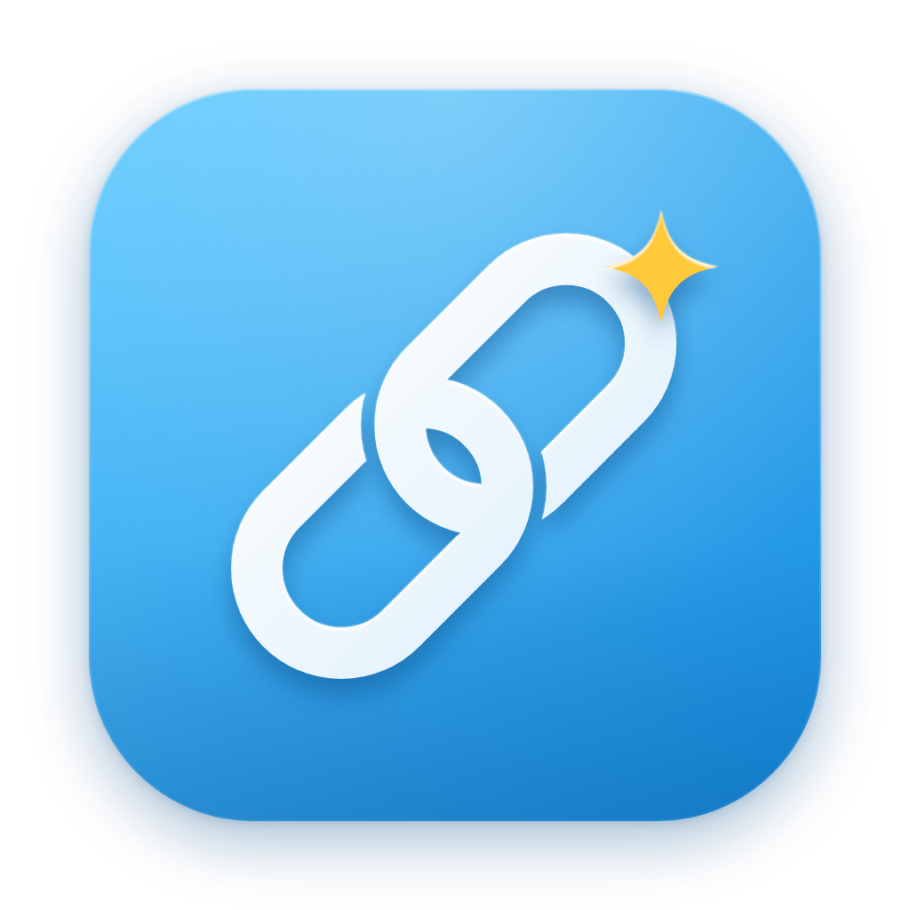
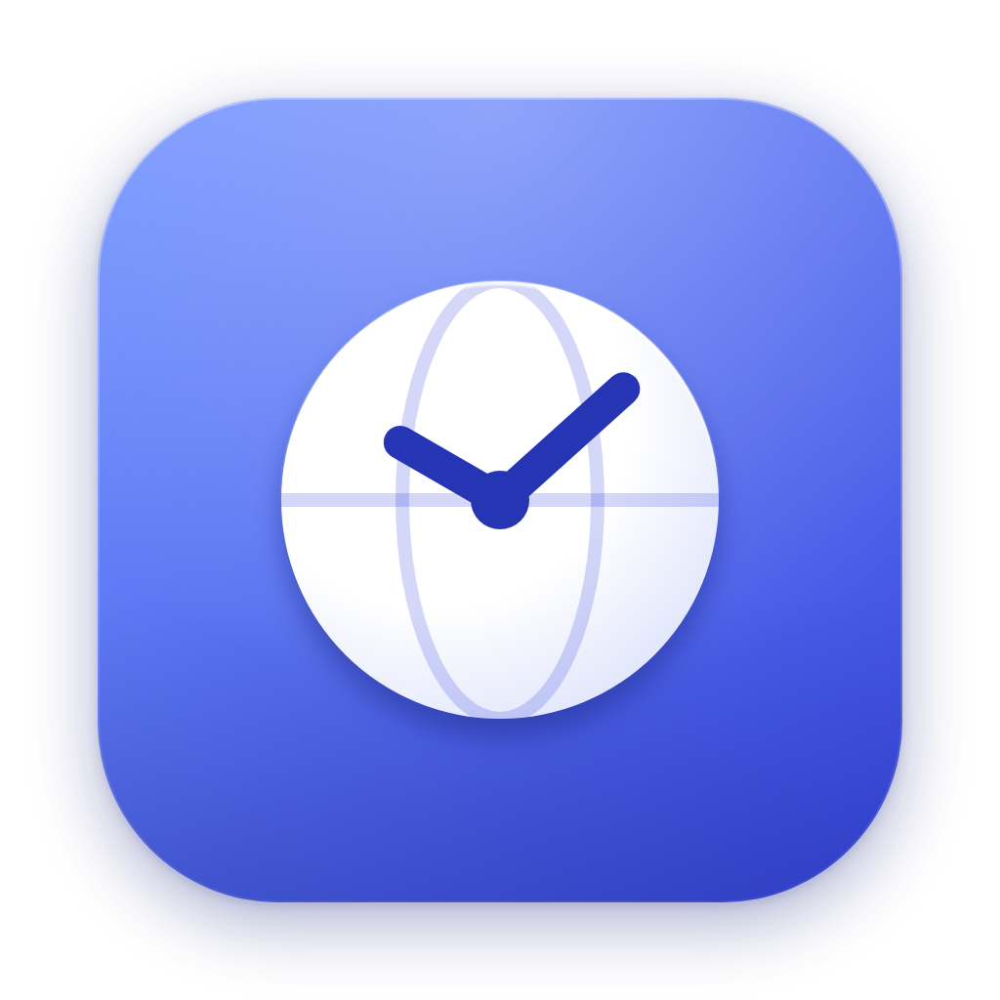
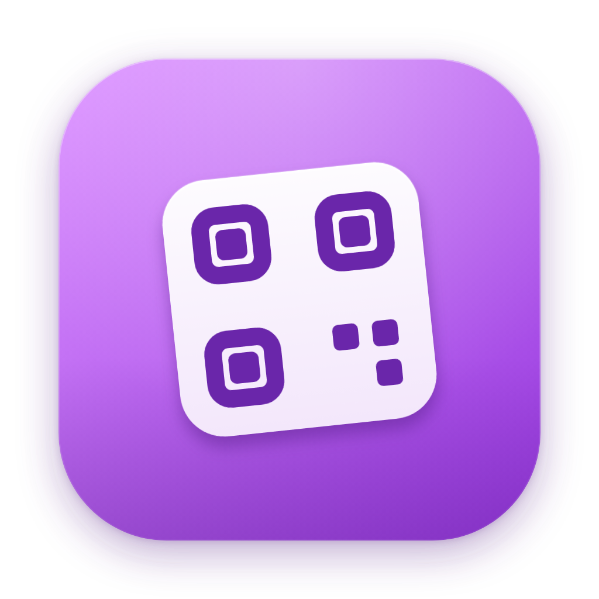
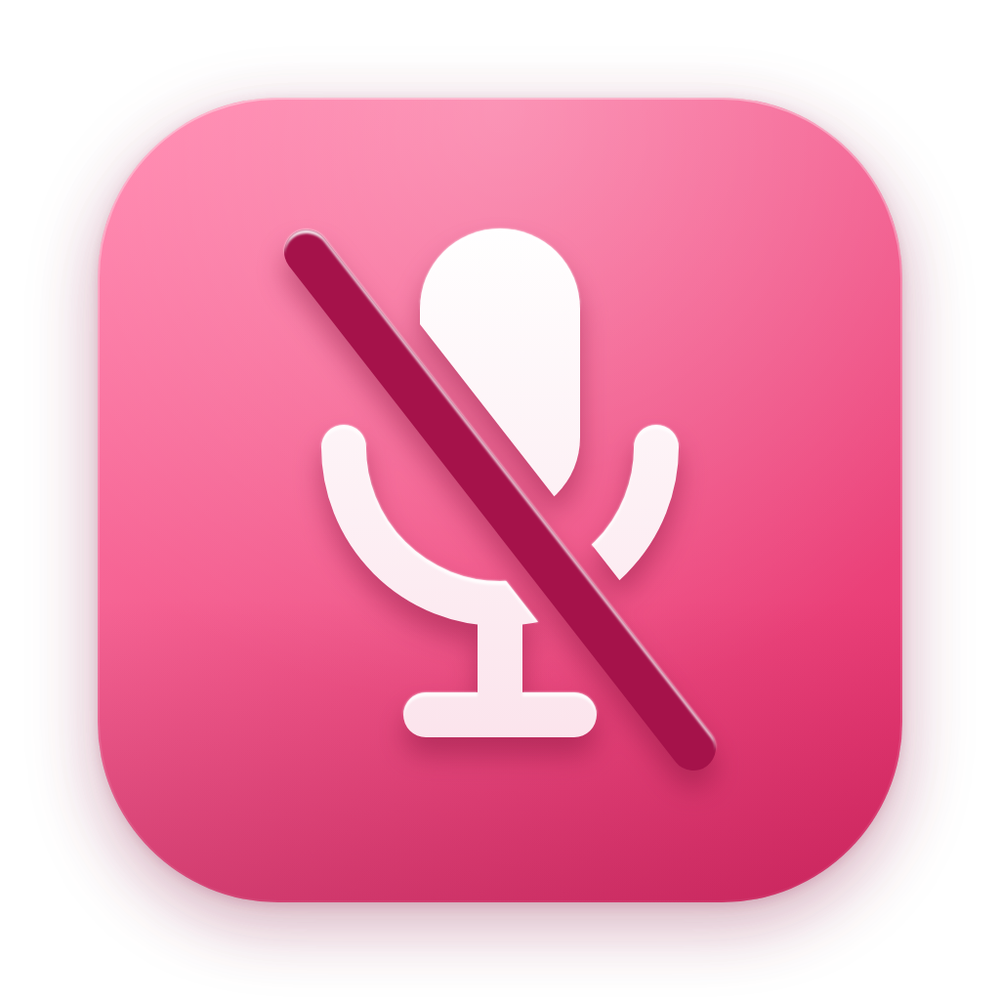
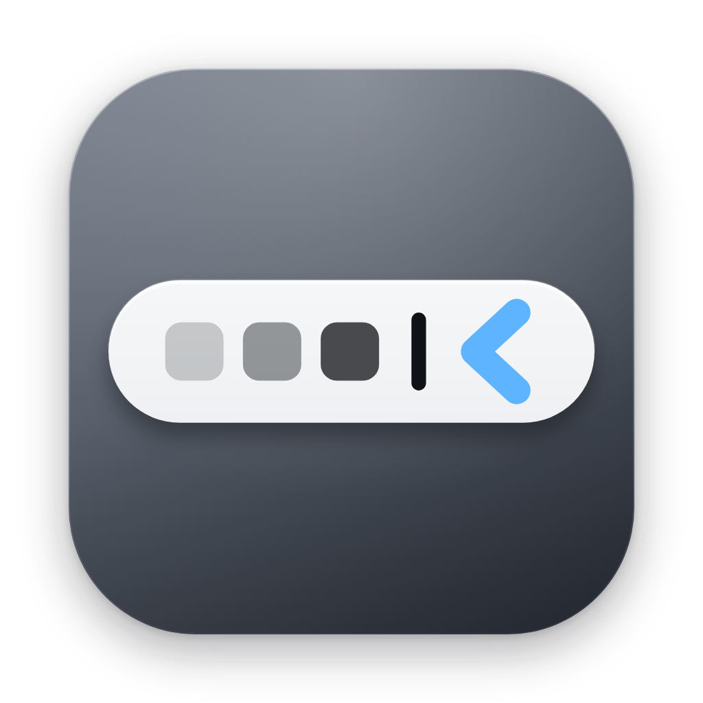

<p align="center">
  
</p>

<h1 align="center">Topside</h1>

<p align="center">
  <strong>Eleven small, free Mac menu bar apps that each solve one small problem.</strong><br>
  Each is its own download and asks only for the permission it needs.
</p>

<p align="center">
  <a href="https://github.com/Luis-Sejer/topside/releases/latest"></a>
  
  
  
  <a href="LICENSE"></a>
  <a href="https://github.com/Luis-Sejer/topside/actions/workflows/ci.yml"></a>
</p>

<p align="center">
  <a href="https://apps.luissejer.dk"><strong>apps.luissejer.dk</strong></a>, try every app in your browser first
</p>

## The apps

| App | What it does | Asks for |
|---|---|---|
| **Week** | The week number in the menu bar ("Uge 40"), and a month calendar with the weeks | – |
| **Awake** | Keeps the Mac and its display awake for 15 minutes to 4 hours, or until turned off | – |
| **Pipette** | Click, pick any pixel, and its hex code is copied. Right-click for recent colors as hex, RGB or SwiftUI | – |
| **Mirror** | Your camera, mirrored, for a look before a call. The camera runs only while it's open | Camera |
| **Upnext** | "Standup in 4 min", and the Teams, Zoom or Meet link one click away | Calendar |
| **Shelf** | Drop files on the icon to park them, and drag them out wherever they're going | – |
| **Scrub** | Strips tracking parameters (utm_source, fbclid, si…) from links as you copy them | Clipboard |
| **Zones** | Your team's local times; pin one city to the menu bar | – |
| **Beam** | The clipboard as a QR code, so your phone's camera can open the link | Clipboard |
| **Hush** | Mutes the microphone itself, so it works in every call app. Click or press ⌃⌥M | – |
| **Drawer** | macOS 27 only. macOS 27 hides the icons that don't fit behind its own » button; Drawer's chevron, or ⌃⌥B, drops down a bar with those hidden icons and a search. Click one and its menu opens from the real icon. Also: a tint, shape, border and shadow for the menu bar, and the spacing between icons | Accessibility, Screen Recording (optional, for the real icon pictures) |

Right-click any icon for Check for Updates…, Open at Login, About and Quit. ⌘-drag an icon to move it in the menu bar.

What's next, including the features that need more permissions: [ROADMAP.md](ROADMAP.md).

## Install

Paste this into Terminal to install every app:

```sh
curl -fsSL https://raw.githubusercontent.com/Luis-Sejer/topside/main/install.sh | sh
```

Only want some? Name them (the names are case-sensitive):

```sh
curl -fsSL https://raw.githubusercontent.com/Luis-Sejer/topside/main/install.sh | sh -s -- Week Hush
```

It installs the apps in `~/Applications` and opens them. Run it again to update. Drawer needs macOS 27, so on macOS 26 the installer skips it.

Every release is built by [GitHub Actions](.github/workflows/release.yml) straight from the tagged source, so what you download is exactly what is in this repository.

<details>
<summary><strong>Install by hand</strong></summary>

1. Download the apps you want and unzip them:
   [Week](https://github.com/Luis-Sejer/topside/releases/latest/download/Week.zip) ·
   [Awake](https://github.com/Luis-Sejer/topside/releases/latest/download/Awake.zip) ·
   [Pipette](https://github.com/Luis-Sejer/topside/releases/latest/download/Pipette.zip) ·
   [Mirror](https://github.com/Luis-Sejer/topside/releases/latest/download/Mirror.zip) ·
   [Upnext](https://github.com/Luis-Sejer/topside/releases/latest/download/Upnext.zip) ·
   [Shelf](https://github.com/Luis-Sejer/topside/releases/latest/download/Shelf.zip) ·
   [Scrub](https://github.com/Luis-Sejer/topside/releases/latest/download/Scrub.zip) ·
   [Zones](https://github.com/Luis-Sejer/topside/releases/latest/download/Zones.zip) ·
   [Beam](https://github.com/Luis-Sejer/topside/releases/latest/download/Beam.zip) ·
   [Hush](https://github.com/Luis-Sejer/topside/releases/latest/download/Hush.zip) ·
   [Drawer](https://github.com/Luis-Sejer/topside/releases/latest/download/Drawer.zip) (macOS 27)
2. Move each `.app` to your Applications folder.
3. Open it. macOS will say it can’t verify the developer, because the apps aren’t notarized with a paid Apple developer account.
4. Open **System Settings → Privacy & Security**, scroll down and click **Open Anyway**. Do this once per app.

</details>

### Install with your AI agent

Using Claude Code, Codex, Cursor or another coding agent? Give it this:

```text
Install Topside on this Mac and check it works, following
https://github.com/Luis-Sejer/topside/blob/main/docs/install/agent.md
```

Name the apps you want, or it installs all of them. It checks your Mac can run them, installs them and tells you how to use them. Ask it to uninstall them the same way.

### Updates

Each app checks GitHub for a new release and, when there is one, offers **Update to …** in its right-click menu; **Check for Updates…** is there too. After updating, it shows what's new once.

### Uninstall

```sh
curl -fsSL https://raw.githubusercontent.com/Luis-Sejer/topside/main/install.sh | sh -s -- --uninstall
```

This removes every app; name apps after `--uninstall` to remove only those. Settings stay, in case you come back. To remove an app's settings too, run `defaults delete dk.sejer.<app>` with the app's name in lowercase, such as `defaults delete dk.sejer.week`.

## Requirements

macOS 26 or later (Drawer: macOS 27), on Apple Silicon.

## Privacy

- Each app keeps its settings locally in its own preferences. No analytics, no tracking, no account.
- Each app asks GitHub whether a new version is out. Nothing about you is sent.
- Apps that need a permission ask for it only when you use the feature that needs it, and only that app asks.

## Build

```sh
./build.sh                  # every app, into build/
./build.sh install Week     # build, install to ~/Applications and launch
./test.sh                   # the logic tests
./release.sh 1.0.0          # tag a release; GitHub Actions builds and publishes it
```

Needs only the Xcode Command Line Tools (`xcode-select --install`). Full Xcode is not required.

## Contributing

Bug reports, ideas and pull requests are welcome. See [CONTRIBUTING.md](CONTRIBUTING.md) to get started, and the [changelog](CHANGELOG.md) for what’s new.

## Support

Topside is free and open source. If it helps, you can [buy me a coffee on Ko-fi](https://ko-fi.com/snickerapp).

## License

[MIT](LICENSE) © Luis Sejer Oliver
